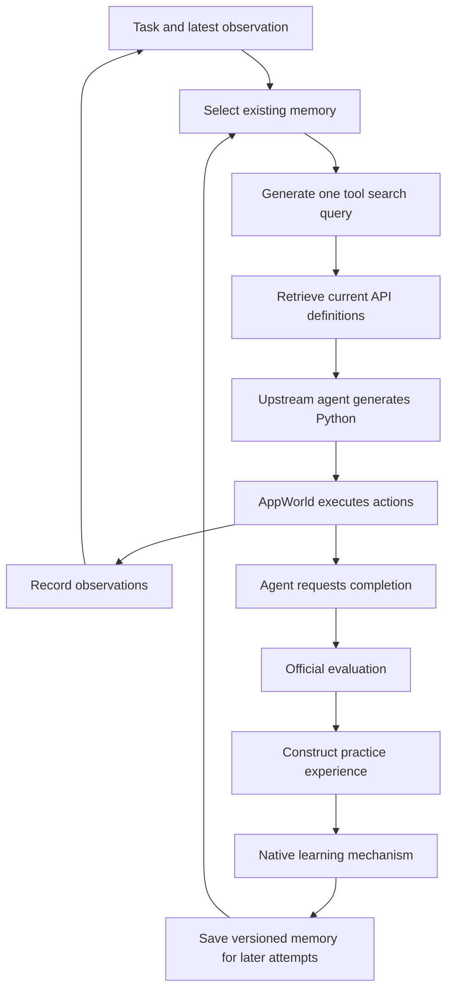

# Code study and executed findings

This project connected five released memory mechanisms to the same AppWorld acting agent and exercised them with real tasks and live Gemini calls. It produced a small measured pilot, concrete memory-and-action cases, and a GEPA instruction that survived selection, persistence and later exposure. It did not establish that every mechanism reliably improves the agent.

The engineering result is an inspectable connection between experience, saved knowledge, supplied context, executable actions and official outcomes. The code also exposed integration failures and limits of treating more memory as better execution.

The [task examples](FINDINGS.md) contain the case-level findings. [Pilot measurements](PILOT.md) contain the six-configuration scorecard. The [public action export](../evidence/cases.json) contains 37 selected task records from the later mechanism cases and their ancestry, not the full initial pilot population. Raw observations and application databases remain outside the public repository, so these exported outcome fields cannot independently regrade the original tasks.

## What was achieved

| Executed work | Observable result | Interpretation |
| --- | --- | --- |
| Connected one acting agent to five memory implementations | The upstream agent executed Python against AppWorld applications and received real observations. | Memory influenced context around an actual actor. |
| Ran the initial pilot | 71 official grades across 72 evaluation cells and 77 actual attempts. | A small comparison with one unresolved outcome and retained failures. |
| Exercised native learning and persistence | Facts, playbook bullets, skill files, episodes and candidate strategies were saved and exposed. | The mechanisms operated; a saved artifact alone does not establish usefulness. |
| Inspected concrete task behaviour | Several actions matched supplied knowledge; irrelevant retrieval and later failures were also observed. | Examples support specific mechanisms and trade-offs rather than a general winner. |
| Completed a GEPA retention diagnostic | Fourteen candidate-testing task attempts selected a nonempty strategy, followed by two frozen-memory and two empty-memory attempts. | Final instruction retention and subsequent exposure were established on known cases. |
| Checked software-owned contracts | The original local source passed 35 metadata/store checks. The publication copy passed its 16 pilot contract checks using installed dependencies. | These are software checks, separate from live-model quality and clean-install verification. |

The initial pilot's official successes/conclusive attempts were baseline 6/12, Mem0 4/12, ACE 4/12, Trace2Skill 7/11, GEPA 5/12 and RecMem 6/12. Trace2Skill had one inconclusive cell. GEPA retained an empty strategy in that pilot, so its difference from baseline cannot be credited to learned instructions. These small results do not establish superiority.

## Where agency and memory meet

AppWorld supplies the applications, upstream tasks and evaluator. Its SimplifiedReActCodeAgent supplies the acting loop. The model generates Python, AppWorld executes it, and observations return for the next decision. The project did not author benchmark reference answers.

[bootstrap.py](../bootstrap.py#L54) makes one constructor change so that the upstream agent accepts the measured model connection. [solve](../growth/agent.py#L81) creates the world, checks reset identity, instruments actual batch execution and preserves the upstream action loop. It records actions, API calls and completion requests. A call to `supervisor.complete_task` ends work; the separate official evaluator determines success.

The later executed integration operates as follows:

During an attempt, existing memory is read and the conversation accumulates observations. Retained cross-task knowledge does not change mid-attempt. [The final memory-export check](../growth/agent.py#L156) rejects an attempt if that store changed while acting. Learning runs after a completed, conclusive practice attempt; conclusive failures are usable experience. Evaluation stores are read-only.

An action error can be corrected within the same attempt. A failed official result does not trigger a universal retry-until-success loop. ACE has scheduled post-update checks, and GEPA makes candidate-testing attempts. The other policies continue according to their learning schedule.

## The code map

| File or function | Responsibility |
| --- | --- |
| [ActingModel.generate](../growth/agent.py#L17) | Select memory, discover tool definitions, construct the actual action request and record exposure. |
| [experience](../growth/runtime.py#L193) | Build learning input from observed steps, actual completion answer and separate evaluator feedback. |
| [Memory.observe](../growth/memory.py#L136) | Schedule supported per-task native learning and record before/after versions. |
| [Memory.evolve_skill](../growth/memory.py#L247) | Analyse trajectories and invoke native skill evolution. |
| [Memory.optimize](../growth/memory.py#L302) | Adapt actual AppWorld candidate attempts to native GEPA evaluation and reflection. |
| [Memory.checkpoint](../growth/memory.py#L376) | Save a memory export and a separate frozen native-store version. |
| [Catalogue.search](../growth/tools.py#L43) | Search names and descriptions of current API definitions using SQLite FTS5. |
| [Vertex.generate](../mc/provider.py#L70) | Dispatch real provider calls and record request identities, usage, timing and uncertainty. |
| [grade_saved](../mc/grading.py#L29) | Independently verify saved final state and invoke the official evaluator. |
| [gepa_retention.py](../gepa_retention.py) | Execute the known-case retention diagnostic and matched controls. |

The initial pilot under `mc/` and the later cases under `growth/` are distinct recorded conditions. The pilot selected context once at task start and used a shared baseline-generated training corpus. The later adapter selected before each action and used each policy's own practice experience. The pilot scorecard must not be described as an evaluation of those later changes.

## Released code entry points inspected

The local adapter links above show the connection to AppWorld. The released mechanisms have their own implementation boundaries:

| Mechanism | Released implementation inspected | Important code behaviour |
| --- | --- | --- |
| Mem0 1.0.0 | Installed `mem0/memory/main.py`, `_add_to_vector_store`, `search`, `_update_memory` and `_delete_memory`. Package version is pinned in [requirements.lock](../requirements.lock). | Fact extraction is followed by retrieval of existing facts and a second model decision about mutations. |
| ACE | Pinned [curator operation filter](https://github.com/ace-agent/ace/blob/82709de050e1db6e6ef2f07bcb0393560b94992a/ace/core/curator.py#L327) and [bullet analyser](https://github.com/ace-agent/ace/blob/82709de050e1db6e6ef2f07bcb0393560b94992a/ace/core/bulletpoint_analyzer.py#L273). | Curator additions and similarity-based consolidation are separate code paths. |
| Trace2Skill | Pinned [ParallelSkillEvolver](https://github.com/Qwen-Applications/Trace2Skill/blob/3d0b52a140f002a512930252b613c49048f7d5ac/skill_evolver/parallel_evolving_agent.py#L3058). | Map, reduction, translation, application and verification are distinct stages. |
| GEPA 0.1.4 | Installed `gepa/core/engine.py`, `gepa/strategies/acceptance.py` and the reflective-mutation proposer. Package version is pinned in [requirements.lock](../requirements.lock). | Proposal acceptance and final candidate selection are distinct decisions; the default acceptance criterion requires strict improvement. |
| RecMem | Pinned [consolidation and ingestion](https://github.com/CaiusDai/RecMem/blob/a84252f6e5587fd4a8caac03ec9f6c732b7a7f35/recmem/rec_mem.py#L248). | Existing-episode merging precedes new raw-memory recurrence gating. |

The code-reading descriptions below are separated from the task observations. A behaviour supported by source inspection is not automatically an observed benefit in a run.

## Mem0 code and evidence

The adapter calls the released `Memory.add` and `Memory.search` APIs. The generation and embedding interfaces are connected to the common measured Vertex client in [the native constructor adapter](../mc/memory.py#L73). Mem0's learned content is not supplied by a hand-written list of API lessons.

In the pinned package, native ingestion first asks the model to extract facts. It embeds candidate facts, retrieves potentially related stored facts, asks the model to choose reconciliation operations, and applies ADD, UPDATE, DELETE or NONE. For each candidate fact, the pinned code retrieves up to five potentially related existing memories before reconciliation, then deduplicates the collected identities. This is fact maintenance through a selected neighbourhood, not a complete comparison against every stored fact. A contradiction outside that neighbourhood can therefore escape the reconciliation input; this is a code-reading implication, not a measured error rate.

The later [input adapter](../growth/memory.py#L56) excludes a task request alone from extraction. A feedback record must include its actual supporting trajectory. The [extraction instructions](../growth/memory.py#L13) distinguish observed API behaviour from harness metadata and prohibit turning a failed guess into a claim that an entire API lacks a capability. These are substantive task adaptations; the released reconciliation engine remains in use.

At action time, native search returns up to ten facts. They are packed and supplied as advisory context. A fact naming descending `play_count` sorting was delivered in the later most-played-song task. The agent called `search_songs(artist_id=3, sort_by='-play_count', page_limit=1)` and passed. A learned `show_transactions` fact was supplied during the successful roommate-spending task.

The mechanism therefore supported inspectable fact recall across tasks. Current documentation was also available, so the source of the successful decision is not isolated. Extraction and reconciliation require additional generation and embedding work. In the preliminary photo check, Mem0 used 12 embedding requests and an estimated $0.043369 in execution expense, versus baseline's $0.014030. These are single observations, not a general cost ratio.

## ACE code and evidence

[The ACE adapter](../growth/memory.py#L192) invokes three released components: Reflector, Curator and BulletpointAnalyzer. The reflector receives the task, recorded executable actions and observations, actual completion answer, evaluator feedback and bullets actually exposed. Its parameter named `reasoning_trace` carries those observable steps, not private model reasoning. [ace_inputs](../growth/memory.py#L43) keeps the actual answer separate from feedback and supplies no reference answer.

The curator proposes playbook additions. In the pinned implementation, the curator filters to ADD operations. The separate analyser embeds bullets, groups similar ones at threshold 0.90 and can merge them. Describing the curator itself as supporting arbitrary native update/delete/merge operations would overstate this code. Helpful/harmful tags are model assessments, and only exposed bullets are credited. The next-bullet counter is preserved across merges to avoid identity reuse.

The acting agent receives the whole playbook. There is no per-bullet applicability selector in this integration.

An ID-first lesson appeared before a successful artist-ranking check. A cross-application lesson appeared before the agent joined current phone contacts with Venmo transactions. In the photo case, an earlier attempt failed; after classification guidance was added, the later check used Amsterdam as the default and overrode it for the specified current-year months, then passed.

These are relevant lessons and compatible actions, with mixed behavioural evidence. The artist task had already passed before its update, and a later spending check failed despite the playbook. ACE made guidance readable and auditable, but did not ensure that the actor applied it correctly or consistently.

## Trace2Skill code and evidence

[The skill adapter](../growth/memory.py#L247) first asks Gemini to turn actual trajectories into structured success and failure findings. It then invokes the released `ParallelSkillEvolver`, whose map phase proposes changes, reduce phase consolidates proposals, and translation/application stages modify skill files. Worker count is one to keep model requests serial. The starting skill contains empty structural metadata, rather than an authored solution.

The recorded skill can contain several text files. Each is exposed as a complete item. The later practice dispatcher evolves skills after six-task blocks; preliminary integration gates had their own small trajectory pools. This is batch learning rather than an update after every action.

The released validation hook referenced a missing dependency. The later adapter supplies a pinned structural validator through that hook and records its actual result. That validates skill format, not whether its API examples will execute successfully or whether its procedure solves a task.

In one successful repeated photo task, the supplied skill identified `show_file` as the metadata source, instructed timestamp conversion, and described directory creation and moves. The agent read metadata, used `datetime.fromisoformat`, checked year and month, created the destinations and moved the files with their names preserved.

This demonstrated three compatible procedural behaviours within one task. It did not establish three independent transfers or prove that the skill was necessary. Current API definitions remained important because the skill examples were schematic.

## GEPA code and evidence

[The GEPA adapter](../growth/memory.py#L302) exposes one editable `strategy` string to the released optimiser. Its evaluator runs the actual AppWorld agent with that candidate and returns official outcomes. Its reflective dataset pairs each candidate attempt with its own instruction, generated actions, answer and diagnostic feedback. A [task-adapted reflection template](../growth/memory.py#L27) asks for reusable guidance rather than copying one task's names, paths or answer.

Native GEPA proposes revisions, evaluates them and applies its acceptance and selection rules. An accepted candidate in its search history is distinct from the final strategy selected and saved for the acting agent. The initial pilot finished with an empty selected strategy. That is an observed result, rather than evidence that its proposed instructions were retained.

The separate [retention diagnostic](../gepa_retention.py#L84) used the same two known task cases for training and selection. It declared completion as the first objective and API-call count as the second. It changed the diagnostic evaluation metric and stop condition while preserving native candidate acceptance. Fourteen candidate-testing attempts selected candidate 2. The store was closed, reopened, compared with its saved export and frozen before later use.

The selected instruction tells the agent to capture original metadata, track changed paths and use the updated paths in later operations. The later file code visibly follows these steps. Both file conditions passed with 156 API calls, so that pair showed no completion or API-call advantage. The Venmo attempt passed with memory and failed without it, but the generic instruction does not explicitly name phone relationships, and initial search results matched. That pair establishes an observed difference with limited causal attribution.

Testing was an additional learning expense: 560 SDK requests and an estimated $0.469273 for construction and candidate testing. The exact instruction, metric, selected candidate, native acceptance history and follow-up identities are in [the retention record](../evidence/gepa-retention.json). The accepted pool contains an empty seed and two saved nonempty revisions. The history also records proposals that failed acceptance. It therefore distinguishes proposing advice from retaining it. This establishes retained instructions and later exposure, not consistent generalisation.

## RecMem code and evidence

[The RecMem constructor adapter](../growth/memory.py#L116) supplies measured generation and embeddings to the released implementation and configures its native stores. [Native selection](../growth/memory.py#L99) captures physical point identities before the public API reduces results to content and score.

The native ingestion order matters. An incoming record first searches for an existing related episode and asks whether to merge. If it is not merged, RecMem checks related raw records. At the later configuration's six-arrival threshold, it can consolidate them into episodes and extract semantic facts. After successful episodic construction, consolidated raw records are removed from the active raw store. Episode updates replace content; semantic extraction inserts new facts, so that layer can continue accumulating items.

The count measures similar experience arrivals, including several records from one task. It does not require six independent successful tasks. The later similarity threshold was 0.7 and episode-merge threshold 0.75. Changing the embedding provider also changes the meaning of those thresholds; adopting the authors' numbers does not establish equivalent retrieval behaviour.

An episode supplied the earlier photo workflow before a passing photo task. Another supplied a relationship-lookup workflow before the agent refreshed current roommate contacts and calculated current Venmo spending. The first episode also accumulated unrelated Venmo feedback. In the artist-following case, the agent passed while retrieving an album-playing episode that did not establish the needed follow operation.

The raw, episodic and semantic mechanisms executed. Consolidation also showed a real boundary-loss risk, and successful execution with irrelevant retrieval cannot be counted as memory help.

## What the integration changed and repaired

| Observed boundary | Code adaptation | What can be concluded |
| --- | --- | --- |
| Inconsistent saved-state/grading metadata under SQLAlchemy 2.1.5 | Pin 2.0.44, verify database identities and compare actual final state with saved state. | A supporting integration fault contaminated the earlier cohort; its outcomes were excluded. |
| Tool search generated repeated synonyms with empty memory | Use a schema-constrained keyword array, validate it and form one FTS query. | The common discovery interface needed repair; this did not establish a Trace2Skill weakness. |
| Mem0 inputs mixed harness metadata and learnable observations | Source-bound extraction and actual trajectory support for feedback. | Learning input semantics are part of the experiment, not a neutral transport detail. |
| ACE answer/feedback mapping and bullet identity handling | Separate answer from feedback and preserve the next identity counter. | The adapter must preserve the native mechanism's intended inputs and identity semantics. |
| Missing skill validator | Connect the pinned structural validator to the native hook. | Actual format validation became available; behavioural validation was not established. |
| Host timestamps entered a simulated world | Use simulated application time in learning copies and keep measurement clocks separate. | Temporal input consistency is integration work. |
| RecMem retrieval discarded native point identities | Capture identities before public result conversion. | Exposure records became more precise without changing delivered content. |
| Standalone simulated-password observations survived redaction | Diagnose the main input defect; add a process-local repair to the separate GEPA diagnostic. | The earlier normalisation contract remained broken, so its results were not silently recertified. |

A successful software check cannot establish that a model-generated lesson is true. A completed native function call cannot establish that a merge preserved meaning. The unchanged failed attempts and mixed outcomes remain part of the findings.

## Retrieval and growing memory

Before each later action, [ActingModel.generate](../growth/agent.py#L17) builds a query from the task and latest actual action/result. Mem0 and RecMem search their stores. ACE supplies the playbook, Trace2Skill supplies skill files, and GEPA supplies the selected strategy. These are different selection policies, not five equivalent selective retrievers.

[Catalogue.search](../growth/tools.py#L43) searches current API names and descriptions and supplies up to eight definitions. Search changes context, not permission: native documentation discovery and executable tools remain available. A call without a previously recognised schema is recorded, not automatically labelled an invalid action.

[Context packing](../mc/provider.py#L190) uses a common 8,192-token allowance and packs whole items. An item that does not fit is omitted and logged. A whole oversized playbook or strategy can therefore disappear from the supplied context. This is a property of the integration, not evidence of successful consolidation or a measured long-term growth result.

Mem0 reconciles facts, ACE merges similar bullets, Trace2Skill revises procedure files, RecMem consolidates recurring records, and GEPA selects instruction versions. None of these operations alone proves that useful knowledge remains retrievable or that the actor can execute it.

## What the work says about memory and agent competence

The saved memory influences a decision through a prompt labelled `Historical memory, advisory only`. There is no mandatory step requiring the actor to select an applicable lesson, translate it into a verified action plan or demonstrate compliance with its conditions. Relevant guidance may be supplied and then ignored, misunderstood or applied incorrectly.

That boundary explains the difference between several claims:

| Claim | Evidence obtained |
| --- | --- |
| The released code was called through the adapters. | Native calls, mutation records, actual persisted artifacts and mechanism events. |
| Saved knowledge reached later action decisions. | Recorded selected content, versions and actual request identities. |
| The agent performed compatible actions. | Executed Python and official outcomes in specific cases. |
| Retained knowledge caused a stable performance gain. | Not established across the five policies. The GEPA diagnostic supplies two known-case pairs, with the qualifications above. |
| More accumulated memory improved long-term performance. | Not established by the executed evidence. |

The conditional engineering lesson is specific. Facts help expose API details; playbooks express recurring guidance; skills express multistep procedures; episodes preserve experience; tested instructions provide a performance-based selection mechanism. Their usefulness depends on correct inputs, preserved conditions, relevant retrieval and competent action. The measured work makes those boundaries inspectable without declaring a universal winner.
